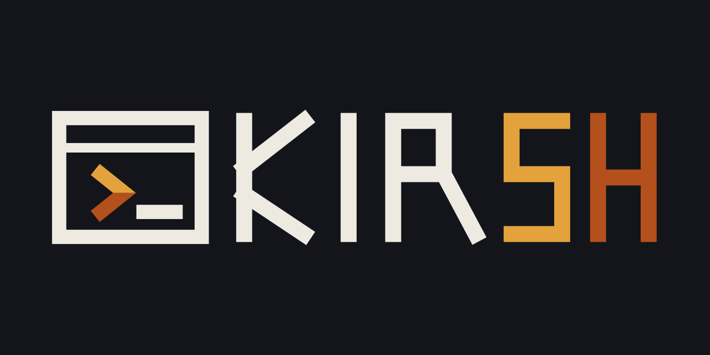

<p align="center">
  
</p>

<h1 align="center">Kirsh Shell Website</h1>

<p align="center"><em>The home of Kirsh, a terminal-native shell being created with Kirn.</em></p>

<p align="center">
  
  
  
  
</p>

<p align="center">
  <a href="https://kirsh-shell.github.io/">Website</a> ·
  <a href="https://github.com/kirsh-shell/kirsh-shell">Kirsh source</a> ·
  <a href="https://kirn-lang.github.io/">Kirn</a>
</p>

## Overview

Kirsh is a terminal-native shell being designed and created with the Kirn programming language. The project explores a command-first workflow where commands, tools, processes, and packages compose naturally. It is an early-stage project, so its implementation and interfaces are still evolving in public.

This repository contains the public Kirsh project website, including its responsive landing page, terminal illustration, SEO metadata, theme controls, ecosystem links, and custom 404 page.

## Website features

- Terminal-inspired visual language with responsive layouts.
- System, light, and dark theme modes with saved preference.
- Animated typewriter messaging in the hero section.
- Search-friendly metadata, Open Graph previews, Twitter cards, and JSON-LD.
- Links to Kirn, Kirnly, Pats, KirnOS, Kirn documentation, and the creator.
- Accessible navigation landmarks, labels, reduced visual complexity, and a dedicated 404 page.

## Related projects

- [Kirsh source](https://github.com/kirsh-shell/kirsh-shell)
- [Kirn programming language](https://kirn-lang.github.io/)
- [Kirn documentation](https://rkriad585.github.io/kirn/)
- [Kirnly editor](https://kirnly.github.io/)
- [Pats registry](https://pats-registry.github.io/)
- [Pats contribution guide](https://pats-registry.github.io/pats/)
- [Stirk AI website](https://stirk-ai.github.io/)
- [KirnOS](https://kirnos-kernel.github.io/)
- [Creator — RK Riad Khan](https://rkriad585.github.io/)

## Local preview

This is a dependency-free static website. Serve the repository with any static HTTP server, for example:

```bash
python3 -m http.server 8080
```

Then open <http://localhost:8080>.

## License

The website content and source are released under the MIT License.
